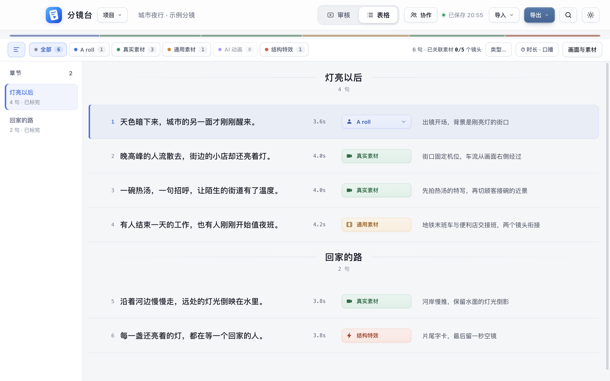

# 分镜台

**把口播稿变成剪辑能直接照着做的分镜方案。**

分镜台是一款 macOS 桌面应用，适合做口播、科普、访谈和故事视频的创作者。导入逐字稿后，你可以逐句决定哪里出镜、哪里配素材、哪里做动画，把画面描述、素材和口播时间放在一起，最后导出分镜脚本交给剪辑。



左侧按章节导航，中间逐句标注画面类型，右侧写画面描述、关联素材。截图使用示例项目。

## 下载与安装

支持 **macOS 13（Ventura）及以上**，按 Mac 的芯片选择安装包：

| 你的 Mac | 下载 |
| --- | --- |
| Apple 芯片（M 系列） | [下载 Apple 芯片版](https://github.com/p56568833/fenjingtai/releases/latest/download/FenJingTai-mac-arm64.dmg) |
| Intel 芯片 | [下载 Intel 版](https://github.com/p56568833/fenjingtai/releases/latest/download/FenJingTai-mac-x64.dmg) |

不确定芯片类型时，打开屏幕左上角的苹果菜单 →「关于本机」查看。下载后打开 DMG，把「分镜台」拖入「应用程序」。也可在 [Releases](https://github.com/p56568833/fenjingtai/releases) 下载 ZIP 版本或查看更新公告。

应用没有苹果开发者签名，首次打开可能被系统拦截：

- macOS 15 及以上：先尝试打开一次，再到「系统设置 → 隐私与安全性」底部点击「仍要打开」。
- macOS 13–14：在应用图标上右键 →「打开」，再确认打开。

后续可在应用内检查更新。有新版本时，点击顶栏「更新」查看公告，下载后重启即可完成更新，项目数据保留。

## 从稿子到分镜

### 逐句规划画面

粘贴口播稿，或拖入 Markdown、TXT、Word 文件，应用会按句拆分并识别章节。默认提供五种标注：

| 类型 | 用来安排什么 |
| --- | --- |
| A roll | 出镜讲述、采访等主体画面 |
| 真实素材 | 实拍、新闻资料、历史影像等 |
| 通用素材 | 可复用的视频、图片等素材 |
| AI 动画 | 需要生成或制作的动画画面 |
| 结构特效 | 字卡、图表、强调信息等 |

点击类型或按数字键即可标注，也可以多选句子批量处理。每个项目都能自定义类型名称、颜色和快捷键。长稿可按章节跳转、搜索内容，或进入「专注标注」，一次处理一句。

连续几句用同一个画面时，选中后点击「共用一个画面」。口播原文仍逐句保留，画面描述和素材统一管理；后续可以调整范围或拆成多个画面。

### 把素材放到对应句子上

把图片、视频或链接关联到画面，直接在应用内预览。视频可以设置入点和出点，只使用其中的一段。

同一画面内的素材可设为「主画面」「叠加」或「备选」，并指定出现在哪几句。应用会提示画面所需时长与视频可用时长，方便检查素材是否够用。素材移动后，可以通过「重新定位文件」修复关联。

### 对着口播检查节奏

导入口播音频后，可以逐句试听，或连播预览口播与主画面。画面时间轨支持调整素材出现的先后和时长。

录制完成后，把剪映导出的 SRT 字幕拖进来，先查看对齐结果，再确认采用实际时间码。尚未对齐字幕时，句子时长按语速或音频总长估算。

### 集中审核视频候选

让 AI 助手按照[候选清单格式](候选清单格式.md)整理视频素材，再把 JSON 清单拖进分镜台。审核页按画面展示对应口播、候选片段、截图、来源和推荐理由。

你可以试看建议的那几秒，选择「通过」「不要」或「换一个」，并写修改意见。通过的片段会关联到分镜，审核结果写回清单，方便继续找素材和返工。

需要交付本地素材时，可批量保存已通过的片段。保存视频片段需在本机安装 [ffmpeg](https://ffmpeg.org/)；已安装 Homebrew 的用户可运行 `brew install ffmpeg`。

### 检查并交给剪辑

导出前可检查未标注、缺少画面描述等问题，也可进一步检查素材关联与文件失联。按交付需要选择：

| 导出格式 | 适合用途 |
| --- | --- |
| PDF 分镜脚本 | 阅读、打印、交给剪辑逐镜执行 |
| 带批注 Markdown | 保留口播原文和画面说明，可再次导入 |
| 素材清单 Markdown | 整理每个画面要用的素材 |
| CSV | 在表格中继续整理、分工 |
| 项目 JSON / 项目包 | 继续编辑，或连同本地素材一起交接 |

项目 JSON 保存分镜与素材关联，交付本地素材时可使用项目包。

## 两个人一起改

2.0 支持同一局域网里的两个人同时编辑一个项目。共享方点击顶栏「协作 → 开始共享」，同事选择项目、输入 4 位配对码即可加入。


句子标注、画面描述和审核结果实时同步，表格会标出同事停在哪一句。断线时可继续编辑，重连后自动合并；撤销只撤回自己的改动。

同一路由器的 2.4G、5G，或 Wi-Fi 与有线连接通常可以互通。若找不到项目，可在「协作」里手动输入共享方显示的地址；访客网络或设备隔离可能阻止连接。

每个项目最多两人协作，本地素材文件和下载的视频片段各自保存在各自电脑上；自己这边缺的素材或口播，对方在线时可以一键从对方电脑拷过来。协作数据在两台电脑之间直接传输，只在信任的网络里使用。

## 数据保存在本机

项目数据存放在 `~/Library/Application Support/分镜台/数据/`，自动保存并定期备份。最近 24 小时内的备份全部保留，更早的每天留一份，保留 30 天。删除的项目可在「最近删除」中找回，保留 30 天。

项目与自动备份不会上传到云端。检查更新、加载在线素材时需要联网，2.0 的协作只与配对的同事传输项目数据。

## 开发

基于 Electron。克隆仓库后运行：

```bash
npm install
npm start
```

使用临时示例数据预览：`npm start -- --preview`。测试使用独立临时数据，不修改正式项目。

```bash
npm test           # 数据、主进程与桌面交互测试
npm run test:data  # 数据与主进程测试
npm run test:ui    # 桌面交互测试
npm run lint       # 架构与代码检查
npm run package    # 构建 Apple 芯片与 Intel 安装包
```

打包产物放在临时 `.noindex` 目录，上传完成后清理。发布时将两个 DMG、两个 ZIP 和 `latest.json` 一起上传，版本标签与应用版本号保持一致。

版本更新记录见 [Releases](https://github.com/p56568833/fenjingtai/releases)。
