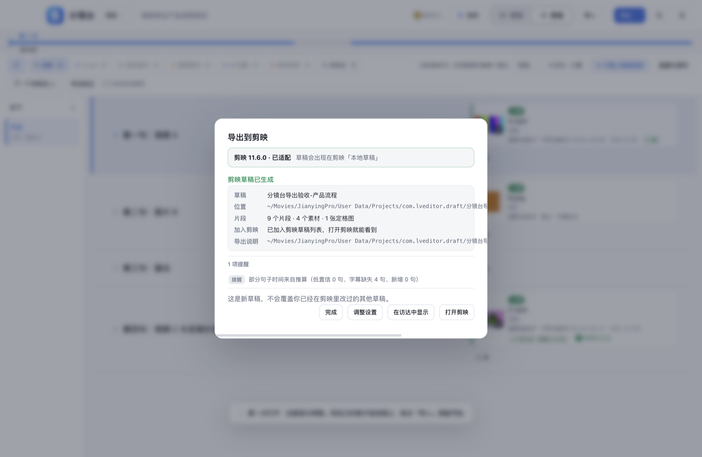
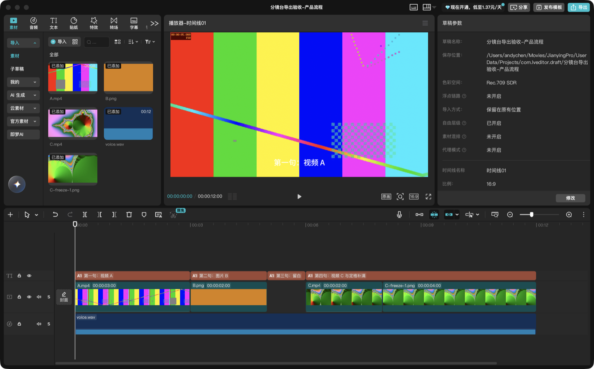
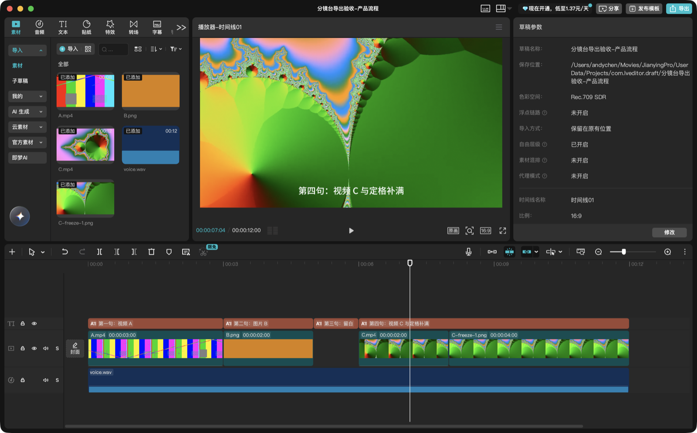
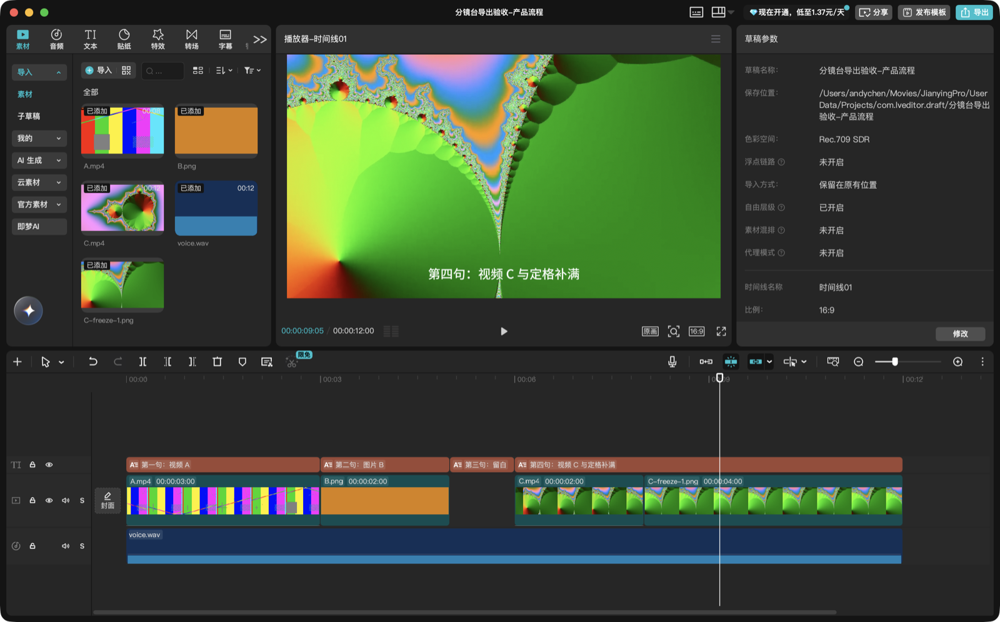
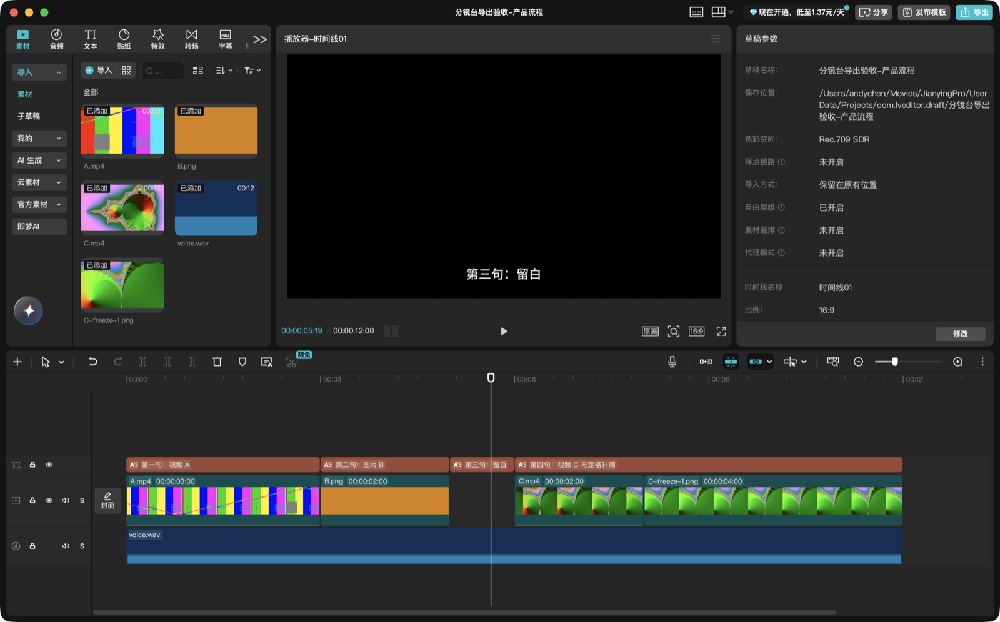
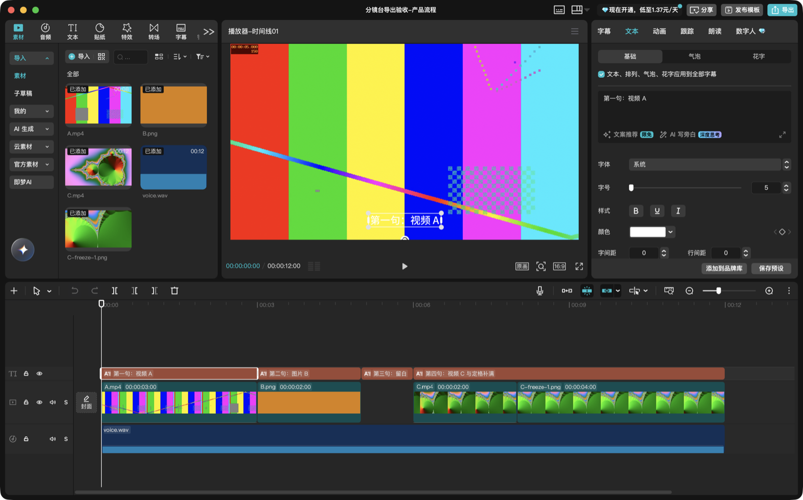
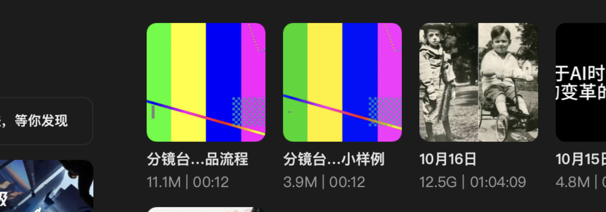
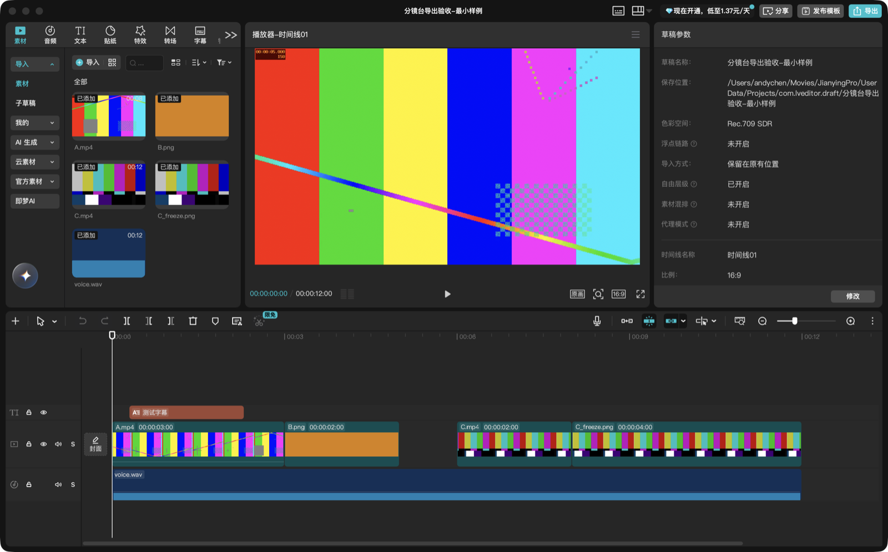
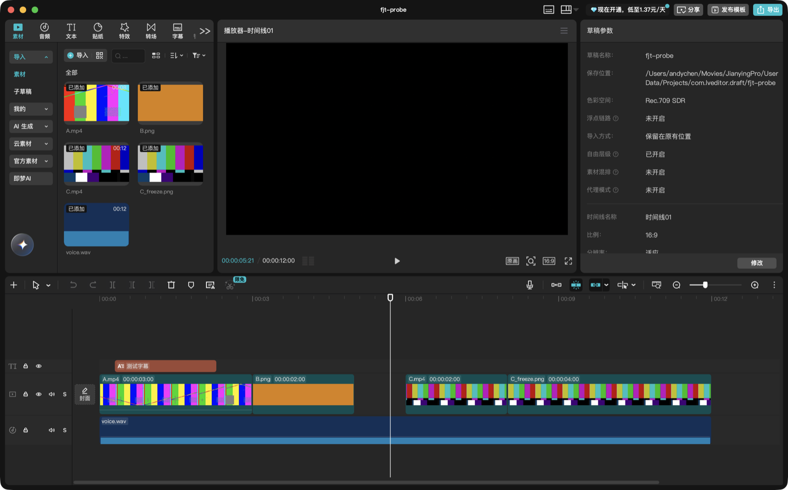
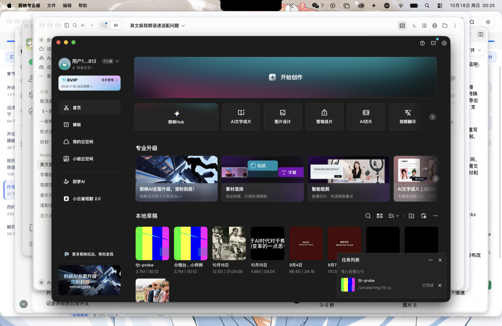

# 分镜台 → Mac 剪映草稿：验收报告

- 目标应用：Mac 剪映专业版 `com.lemon.lvpro` **11.6.0**
- 验证机器：macOS 27.0.1（Apple 芯片）
- 验证日期：2026-10-18
- 验证范围：默认 1920×1080 / 30 fps / 含口播与可选字幕的固定 12 秒样例
- 结论：**默认设置下，分镜台真实导出入口生成的草稿已在剪映 11.6.0 打开、播放、保存、关闭并重新打开，媒体在线、时间关系与定格补满正确。** 其余设置与异常路径见「待验收」。

> 本报告只写实际做过的验证。没有真实剪映证据的内容一律列在「待验收」，不把代码测试、JSON 合法或文件已生成当成兼容性通过。

## 1. 目标版本与格式结论

| 项目 | 实测结论 |
| --- | --- |
| 草稿库 | `~/Movies/JianyingPro/User Data/Projects/com.lveditor.draft/`，索引 `root_meta_info.json` 为明文 JSON，`all_draft_store` 数组 |
| 新草稿发现 | 新建草稿目录并在索引中追加一条后，会出现在剪映「本地草稿」列表，可以从列表直接打开 |
| 主文件 | `draft_info.json`（明文 JSON 被接受；剪映打开后会加密重写，单向） |
| 元信息 | `draft_meta_info.json`（明文被接受；媒体池 `draft_materials` type 0 需要登记素材） |
| 结构版本 | `version: 360000`，`new_version: "189.0.0"`（以本机 11.6.0 自产明文结构为形状基准） |
| 素材 | 默认复制进草稿 `Resources/`，`draft_info.json` 与 meta 写最终绝对路径；剪映能直接播放，无「媒体丢失 / 暂无访问权限」 |
| 时间单位 | 微秒整数；索引时间也用微秒（毫秒会被剪映显示成 1970 年并排到最后） |
| 画布/帧率 | 1920×1080 / 30 fps 已验证；其余画幅帧率只做结构与单元测试，未实机打开 |
| 空档 | 主轨 5–6 秒空档保留，未被自动吸附消除；后续画面没有提前 |
| 定格补满 | 视频段 + 取源区间最后一个可解码帧的 PNG 段相邻放置；实测 8–12 秒画面静止，与 6–8 秒视频运动帧可区分 |
| 音频 | 口播作为独立音轨放 0–12 秒，只出现一次；视频画面原声没有自动铺成 A roll |
| 字幕 | 可编辑文字轨；剪映属性面板能读到文字内容，并可改字号、颜色、位置 |
| 直接登记 vs 官方导入 | 直接索引登记可打开；另外 `.jypack`（草稿包）导入也能被剪映识别并加入列表，可作为替代路径 |
| 保存后结构 | 剪映打开明文草稿后会重写为加密 `draft_info.json` / `draft_meta_info.json`，并补齐 `Timelines/`、`.backup/` 等自身文件；属于预期单向升级 |

## 2. 已完成的实机验证

### 2.1 产品真实导出入口（主验收）

使用真实渲染层「导出 → 导出到剪映」入口，从一份合成测试项目生成草稿（不是底层脚本直接拼 JSON）：

- 入口：分镜台导出菜单 →「导出到剪映」→ 弹窗「生成剪映草稿」。
- 目标检测：显示「剪映 11.6.0 · 已适配」，草稿库可用。
- 设置：草稿名「分镜台导出验收-产品流程」；保存方式「加入本机剪映草稿」；默认 1920×1080 / 30 fps；勾选「生成可编辑字幕」；备选不复制。
- 摘要：9 个片段 · 4 个素材 · 1 张定格图；有 1 项提醒（部分句子时间来自推算，如实提示）。
- 结果：显示草稿位置、片段数、已加入剪映草稿列表、「在访达中显示」「打开剪映」、导出说明路径。

生成后的草稿目录（验收工作数据）：

`~/Movies/JianyingPro/User Data/Projects/com.lveditor.draft/分镜台导出验收-产品流程/`

包含 `draft_info.json`、`draft_meta_info.json`、`draft_cover.jpg`、`draft_settings`、`Resources/`（A.mp4、B.png、C.mp4、C-freeze-1.png、voice.wav）、`字幕.srt`、`导出说明.md`、`fenjingtai-export.json`。

在剪映 11.6.0 中打开后：

- 标题栏显示「分镜台导出验收-产品流程」，媒体面板 5 个素材全部在线，无媒体丢失提示。
- 时间线：A.mp4 0–3 秒、B.png 3–5 秒、5–6 秒空白、C.mp4 6–8 秒、C-freeze-1.png 8–12 秒、voice.wav 0–12 秒、四条字幕 0–12 秒；总长 00:00:12:00。
- 播放/定位：0–3 秒 A 在动；5.5 秒黑场并显示「第三句：留白」字幕；7.0 到 7.5 秒 C 的画面持续变化；9.0 到 9.6 秒定格画面逐像素一致（属同一张末帧图），证明视频段与定格段是不同片段且没有把定格误做成视频。
- 关闭后重新打开同一草稿，时间线、字幕、口播、定格仍完整（剪映已将其转为加密保存）。

### 2.2 独立兼容性探针（格式实证）

在产品实现前，先用独立合成素材和独立草稿目录验证格式本身：

| 时间 | 内容 |
| --- | --- |
| 0–3s | 视频 A，源片 5–8s，1 倍速 |
| 3–5s | 图片 B |
| 5–6s | 用户手动留白 |
| 6–8s | 视频 C，源片 10–12s |
| 8–12s | 视频 C 选定出点前的末帧定格（PNG 独立片段） |
| 0–12s | 独立口播音轨 |
| 0.3–2.3s | 可编辑文字轨测试字幕 |

验证结果：草稿出现在列表、可打开；播放跨越每个边界时画面符合上表；B 未抢占留白、C 未提前；关闭再打开时间线仍在。该探针草稿保留在：

`~/Movies/JianyingPro/User Data/Projects/com.lveditor.draft/分镜台导出验收-最小样例/`

### 2.3 官方草稿包导入（替代路径）

把同一份草稿目录打成 `.jypack` 后用 Finder / `open` 打开，剪映 11.6.0 成功导入并登记为独立草稿，任务列表显示「导入任务 已完成」。该路径可作为「保存草稿文件夹」后的手动交付方式，但产品默认仍走直接登记。

## 3. 待验收项（没有实机证据，不宣称完成）

- [ ] 9:16、1:1 画幅与 25 / 24 / 60 fps 的真实剪映打开验证（默认画幅帧率已实机验证）。
- [ ] 口播源为视频时的真实剪映回归（抽音轨能力已实现并由 ffmpeg 冒烟 + 单元测试覆盖，未在剪映里打开对应草稿）。
- [ ] 在剪映属性面板里实际改写字幕内容并保存重开（已确认是可编辑文本轨、属性面板可读写，但本次没有改字后重开）。
- [ ] 手工移动/裁剪一个片段后保存、关闭、重开保留。本次在剪映内裁剪了 B 片段，界面内生效并触发自动保存，但重开后回到原时长；合成拖拽的提交与真实鼠标行为是否一致尚未定论，需用真实鼠标复核。
- [ ] 剪映运行中「先生成草稿、退出后补登记」的完整 UI 流程（代码与单元测试覆盖，未做真实剪映打开）。
- [ ] 无设备指纹机器（找不到任何明文旧草稿）的降级生成与打开验证（代码会给 warning，未实机打开）。
- [ ] 大量素材 / 长项目 / 磁盘不足 / 取消 / 外置盘断开等文件任务异常的真实剪映回归（单元测试与文件级测试已覆盖）。
- [ ] 备选素材是否进入剪映素材面板（目前只复制到 `Resources/备选素材/`，不上时间线、不登记素材库，需实机确认）。
- [ ] CapCut 国际版、Windows 剪映、其他 Mac 剪映版本不承诺支持。

## 4. 测试与代码验证

实际执行结果：

| 命令 | 结果 |
| --- | --- |
| `npm run lint` | 通过；架构检查 150 个模块无循环依赖，eslint 0 error |
| `env -u ELECTRON_RUN_AS_NODE npm run test:data` | 通过；含原有 production / collab / main / crash 回归 + 剪映计划 49 项 + 剪映文件任务 30 项 |
| `env -u ELECTRON_RUN_AS_NODE node scripts/test.mjs` | 通过；784 项界面/行为自测 0 失败（首次运行有 1 项播放时序用例因系统负载抖动失败，重跑通过） |
| `env -u ELECTRON_RUN_AS_NODE npm run test:theme` | 通过；12 项主题动画/像素回归 |
| `npx prettier --check` | 新增/修改文件通过（已格式化） |

新增自动化测试：

- `scripts/jianying-plan-test.mjs`（49 项）：固定 12 秒样例逐段边界；多素材排序、共用画面去重、同素材多区间、`off` / 旧项目回退 / `at.of` 失效、自然停顿、手动留白、无素材句、开头/尾部、srt/fit/rate/低置信/gap、定格/越界/重叠/零长诊断、30 分钟多片段 ≤1 帧精度、快照无副作用。
- `scripts/jianying-files-test.mjs`（30 项）：草稿结构引用完整、特殊字符路径、同名去重、源文件复用、定格抽帧、视频口播抽 m4a、取消、磁盘不足、索引备份/冲突/不可解析/剪映运行中/补登记、重复导出、原子提交失败回滚、旧暂存清理、无指纹降级、平台探测、IPC 参数/单任务/取消/事件解绑、native/preload 接口。

## 5. 使用步骤与完整性边界

### 使用

1. 在分镜台里排好素材、裁剪和定格补满。
2. 点导出菜单 →「导出到剪映」。
3. 首次按需确认：目标版本、草稿名、保存方式（加入本机剪映草稿 / 保存草稿文件夹）、画幅、帧率、是否生成字幕、是否复制备选素材。
4. 点「生成剪映草稿」，等待阶段完成。
5. 成功后打开剪映，在「本地草稿」里找到新草稿继续剪。

### 自动上轨 / 只附带 / 需要在剪映安排

- **自动上轨**：主画面视频和图片、按分镜台预览的时间位置、源入出点、手动留白、自然停顿、定格补满（视频 + 末帧 PNG 两个相邻片段）、口播独立音轨、可选的字幕文字轨。
- **只附带**：备选素材（勾选后复制到 `Resources/备选素材/`，不上时间线）、字幕 SRT、导出说明和机器可读报告。
- **需要在剪映里安排**：叠加素材首版不自动上轨；只有 URL 的素材需先在分镜台落成本地文件；AI 动画/特效的文字描述没有关联实际媒体时保留说明与空缺。

## 6. 已知限制

- 只承诺本机 **Mac 剪映 11.6.0**；其他版本未验证。界面上按「预览/已适配 11.6.0」表述，不泛称支持所有 Mac 剪映。
- 剪映打开明文草稿后会加密重写，分镜台不做回读、不做双向同步；再次导出会生成新的独立草稿。已经打开过的草稿无法再补登记（会提示重新导出）。
- 草稿的 `platform` 字段含本机设备标识（`device_id` 等），只在生成时本机探测并写入草稿，不进入项目数据、不广播给协作者；自包含草稿目录不建议直接对外分发。
- 定格抽帧、视频口播抽音轨、封面抽帧依赖本机 ffmpeg；缺 ffmpeg 时只阻塞实际依赖这些处理的部分，纯音频且无需定格的基础草稿仍能生成。
- 首版不做转场、滤镜、配乐自动匹配、智能节奏重剪，也不支持 CapCut / Windows / 跨机器任意搬动无需修复。
