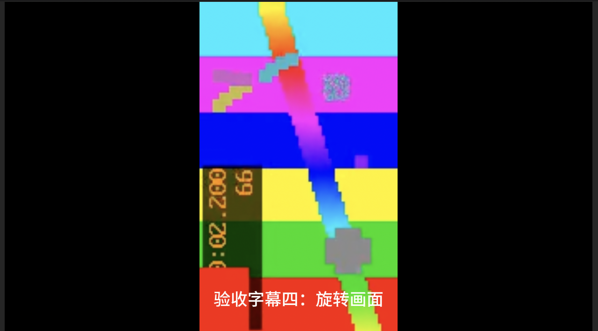
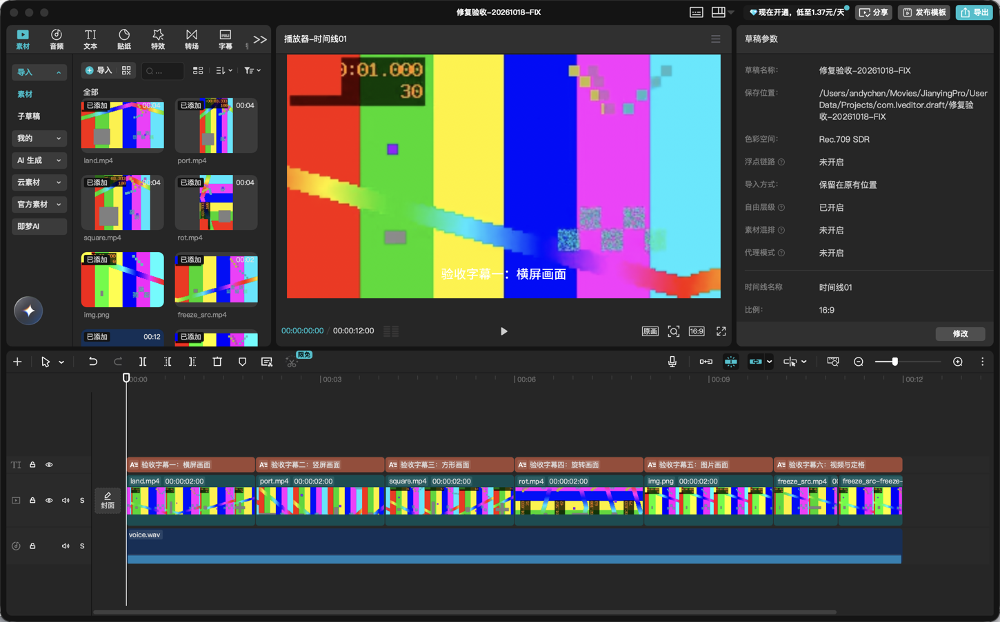
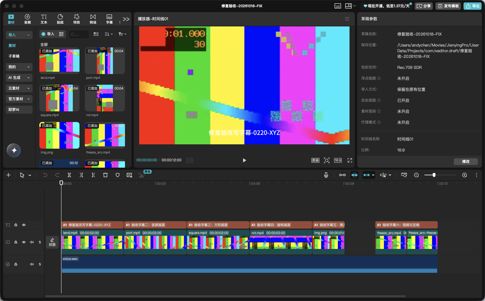
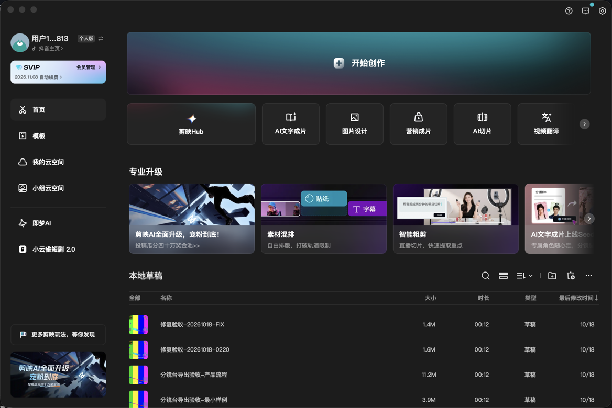
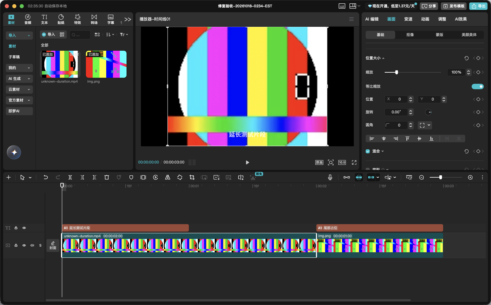
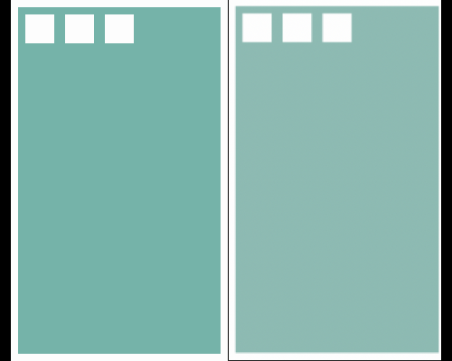
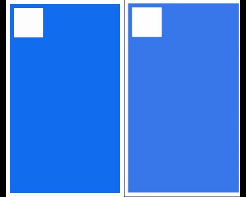
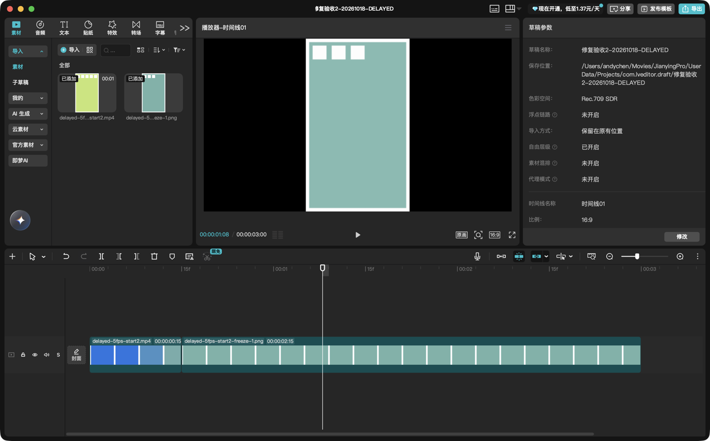
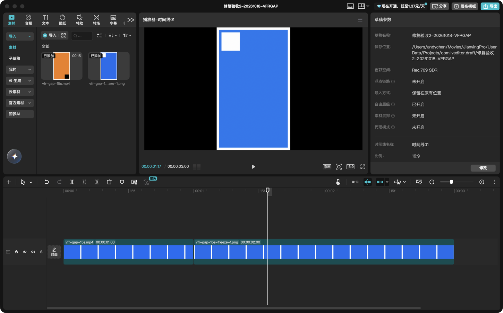
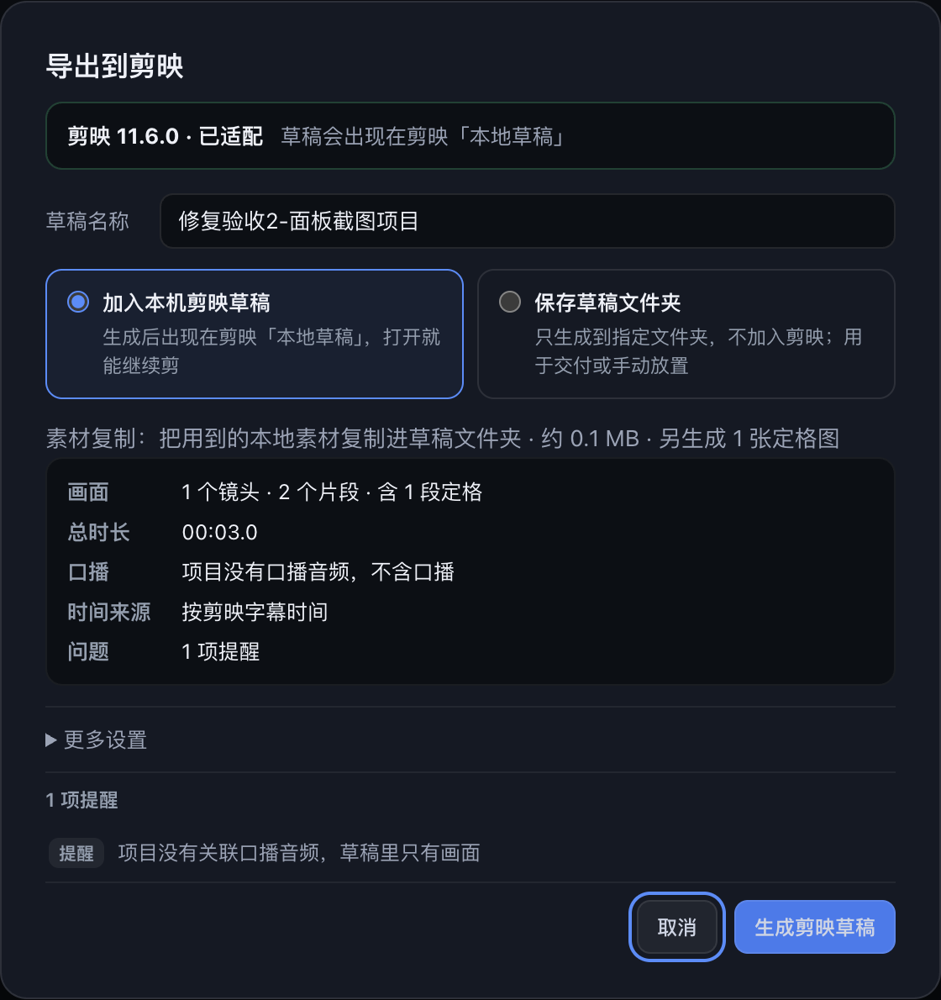

# 分镜台 → Mac 剪映草稿：验收报告

- 目标应用：Mac 剪映专业版 `com.lemon.lvpro` **11.6.0**
- 验证机器：macOS 27.0.1（Apple 芯片）
- 验证日期：2026-10-18（功能首轮验收）；2026-10-18（修复轮，针对本地提交 `0944660` 的验收问题）；2026-10-18（第二轮修复，针对定格时间基准、VFR 长静止与剪映版本识别）
- 验证范围：默认 1920×1080 / 30 fps / 含口播与可选字幕的固定 12 秒样例；修复轮另用独立合成草稿验证定格选帧、真实媒体尺寸/方向、剪映运行状态接线、索引日期与编辑保存重开；第二轮另用延迟 2 秒起点与 VFR 长静止素材验证真实导出与定格选帧，并复核 11.6.0 的版本识别与导出面板状态
- 结论：**默认设置下，分镜台真实导出入口生成的草稿已在剪映 11.6.0 打开、播放、保存、关闭并重新打开，媒体在线、时间关系与定格补满正确。** 修复轮的 1–5 项已修复并有可复现旧错误的回归测试；第 6 项“编辑后重开恢复原状”在真实鼠标操作下**未复现**，保存/重开/重启均保留修改。第二轮三个问题已修复：两类定格素材在真实导出与剪映 11.6.0 中都取到正确画面，未验证版本不再显示「已适配」、也不能生成或登记草稿。具体见 §0 与 §0.7；其余设置与异常路径见 §3/§0.5。

> 本报告只写实际做过的验证。没有真实剪映证据的内容一律列在「待验收」，不把代码测试、JSON 合法或文件已生成当成兼容性通过。

## 0. 2026-10-18 修复轮（0944660 的验收问题）

> 本节记录本轮实际复现、修复和真实剪映验证的结果。首轮报告（§1–§6）保持原样作为历史；其中已过时的结论在本节和 §3 的对应条目里注明。第二轮的三个问题（定格时间基准、VFR 长静止、版本识别）单独记录在 §0.7，不并入本节的旧修复清单。

### 0.0 范围与结论

- 被验收提交：本地 `0944660`（未推送、未发布 Release、未替换 `/Applications/分镜台.app`；开发版本仍为 2.0.9）。
- 问题 1–5 已修复，且新增回归都能在旧实现上失败：定格源帧定位、剪映运行状态生产接线、真实媒体元数据、工具缺失/媒体损坏区分、索引时间单位。
- 问题 6：用**真实鼠标**在两份独立合成草稿（基线 0220、修复版 FIX）上裁剪片段并改写字幕，等剪映自动保存后关闭重开、再完全退出重启打开，两次都**保留修改、没有回退**。旧报告“重开后回到原时长”未复现，更像是当时合成拖拽事件没有真正提交。
- 真实剪映 11.6.0 已复核：1920×1080/30fps、横/竖/方/旋转视频、图片、视频+定格衔接、5fps 定格取 0.4s 帧、草稿列表日期/置顶、编辑保存重开、未知源时长经推算后延长裁剪。
- 未验证的版本、画幅、帧率不写入“已验证”，见 §0.5。

### 0.1 已复现缺陷（旧实现实测）

| #   | 问题                   | 旧实现实测结果                                                                                                                                                                                                                      | 证明方式                                                                                                                                       |
| --- | ---------------------- | ----------------------------------------------------------------------------------------------------------------------------------------------------------------------------------------------------------------------------------- | ---------------------------------------------------------------------------------------------------------------------------------------------- |
| 1   | 定格帧取错             | 5fps 源、裁剪出点 0.51s、30fps 项目：旧计划给出 `atUs=476667`，旧 `extractFrame` 用输出侧 seek 取到源 **0.6s（第 3 帧）**；正确是 **0.4s（第 2 帧）**                                                                               | `scripts/jianying-freeze-test.mjs` 同时跑“旧 seek 对照”和“新逻辑”，断言两者抽到的颜色不同；真实剪映 FREEZE 草稿显示定格帧时间戳 `00:00:00.400` |
| 2   | 运行状态接线失效       | 生产默认 `runJianyingExport(request,hooks,deps)` 没有把实时 `isRunning` 传下去，导出器退回 `request.running` 旧快照；用修复版链路测试跑 `0944660` 代码：**10/13 失败**（复制中启动/退出、检测失败、复制期索引变更、补登记 1970 等） | `/tmp/jy-base`（0944660 + 新 clock）实跑 `jianying-index-ipc-test.mjs`，失败输出保留                                                           |
| 3   | 真实媒体元数据丢失     | 旧 `schema` 对计划里宽高为空的 320×180 视频写 **1920×1080**、`has_audio=true`；主进程探测结果没有传给草稿生成器                                                                                                                     | 旧 `buildDraftInfo` 直跑实测；新 media 测试断言真实尺寸/方向/完整时长                                                                          |
| 4   | 工具缺失与媒体损坏混淆 | 旧 `probe()` 失败返回 `null`，调用方 `if (!info) continue`：文本内容伪装 `.mp4` 的必需视频也能 **ok:true** 导出，只多一条“封面用默认图”                                                                                             | 旧 exporter 真跑输出 `ok:true`；新测试断言 `ok:false` 且问题定位到素材和句子                                                                   |
| 5   | 索引时间单位错误       | 旧 `registerDraft()` 默认把 `Date.now()` 毫秒当微秒写索引：实测 `tm_draft_create=1792260903486` → **1970-01-21**；补登记草稿在列表里排到最后                                                                                        | 旧 register 真跑实测；新测试默认时钟/注入时钟都断言正确日期                                                                                    |
| 6   | 编辑后重开恢复原状     | 本轮真实鼠标链路**未复现**：基线 0220 和修复版 FIX 的裁剪+字幕改动都提交了自动保存，关闭重开与完全退出重启后保留                                                                                                                    | 见 §0.3 的改前/改后数值、截图与 hash                                                                                                           |

### 0.2 修复内容与文件职责

- `renderer/src/core/edit-export-plan.js`：定格派生新增 `sourceInUs`/`sourceOutUs`（源微秒、出点排他）；`atUs` 只保留为旧计划兼容提示；定格宽高不再写画布尺寸；素材条目增加 `refs`（定位到原句）。
- `electron/jianying/frame.js`（新）：ffprobe 读取真实源帧 PTS，选“PTS < 排他出点且可见区间与源区间相交”的最后一帧，用前一帧与目标帧 PTS 中点精确定位抽 PNG；不再按项目帧率推算，也没有 0.2s/1s 盲退。错误分 `media-tool-missing` / `media-no-video-stream` / `freeze-range-missing` / `freeze-no-frame` / `frame-extract-failed`。
- `electron/jianying/media-info.js`（新）：归一化真实宽高/旋转/帧率/完整时长；按文件头读 PNG/JPEG/GIF/WebP 尺寸；把探测失败区分为工具缺失、探测超时、不支持、损坏/非媒体、解析失败；容器没有总时长时按视频包时间戳推算（标记为推算值）。
- `electron/jianying-export.js`：冻结抽帧委托 `frame.js`；必需素材全部真实探测并分类，失败问题带 `rowId/lineNo/assetId`；把真实媒体元数据通过 `media` Map 传给 `schema.buildDraftInfo` 与素材库生成；定格使用 PNG 真实输出尺寸；登记前重新检测剪映运行状态（检测失败保守不写索引）、比对导出开始时的索引原文；视频容器缺时长且有可解码包时写推算时长并给提醒。
- `electron/jianying/schema.js`：`buildDraftInfo` 新增 `media` 参数；素材宽高只认真实值（未知写 0，绝不回退画布）；视频 duration 用完整源时长（不只是本次使用区间），保留进剪映后继续延长裁剪的空间；`has_audio` 用真实探测值。
- `electron/jianying/platform.js`：`isRunning()` 在检测命令本身失败时抛错，不再静默当作“没运行”。
- `electron/jianying/clock.js`（新）、`register.js`：所有注入/默认时钟按毫秒，`entryFromDraftDir` 内唯一一次转微秒；索引备份文件名用正常本地日期；`registerDraft` 写索引前可再查一次 `isRunning`，运行中或检测失败都拒绝写。
- `electron/ipc-jianying.js`：默认 `runExport` 把实时 `isRunning` 传进导出任务；补登记同样把实时检测交给 `registerDraft`。
- `renderer/src/app/edit-export.js`、`features/jianying-export.js`：预检只负责存在性（尺寸由主进程提供）；结果区区分“剪映正在运行”和“无法确认剪映状态”两种保守提示。
- 测试：新增 `scripts/jianying-freeze-test.mjs`（8 项真实 ffmpeg 抽帧+画面比对）、`scripts/jianying-media-test.mjs`（16 项真实媒体/损坏媒体/元数据/推算时长）、`scripts/jianying-index-ipc-test.mjs`（13 项时钟/排序/真实 IPC→导出→登记链路）；`scripts/jianying-files-test.mjs` 的图片 fixture 换成真实 PNG 头；`scripts/jianying-live-verify.mjs` 是真实剪映导出驱动（不接入 npm test）。
- `package.json` 把 3 个新脚本接入 `test` / `test:data`；`UPDATE-NOTES.md` 补 4 条【修复】；`docs/ARCHITECTURE.md` 同步新模块职责。

### 0.3 真实剪映 11.6.0 验证（本轮实际做过的）

环境：macOS 27.0.1（Apple 芯片）/ Mac 剪映专业版 `com.lemon.lvpro` **11.6.0**（只声明 11.6.0 实测，不泛称全部 11.6.x）。所有操作均使用新建的独立合成草稿；用户原有草稿只读、未打开修改、未删除。

独立测试草稿（保留作验收工作数据，不参与软件清理）：

- `~/Movies/JianyingPro/User Data/Projects/com.lveditor.draft/修复验收-20261018-0220/`（阶段 A 基线；导出时工作区已有部分修复，**不是 0944660 纯旧代码**，issue 6 用它做基线）
- `.../修复验收-20261018-FIX/`（阶段 B 主验收）
- `.../修复验收-20261018-FREEZE/`（5fps 定格）
- `.../修复验收-20261018-UNKNOWN/`、`.../修复验收-20261018-UNK2/`、`.../修复验收-20261018-KNOWN2/`（未知时长 A/B 对照）
- `.../修复验收-20261018-0234-EST/`（加 packet 推算兜底后的未知时长复核）

#### 0.3.1 结构、画幅与方向

FIX 草稿明文 `draft_info.json`（02:18:11，registered=true）：`land 320×180`、`port 120×200`、`square 180×180`、`rot 120×200（display，文件 rotation=90）`、`img 240×160`、定格 PNG `320×180`；视频 duration 均为完整源时长（4s/2s，不是使用区间的 2s/1s）；画布 1920×1080；索引 `tm_draft_create=1792261091382000`（µs = 2026-10-18 02:18:11），列表置顶、最后修改时间 10/18。

剪映里逐段播放核对：横屏填满、竖屏与方形居中留黑边、图片 3:2 比例正确、旋转素材显示 120×200 竖向且红块/时间戳方向正确、视频段与定格段相邻且 11.2s 与 11.8s 画面一致、10.3s 不同。修复版 7.2s 旋转画面与基线 7.2s 帧**逐像素相同**（docs 中实际 PNG 的 `shasum -a 256` 均为 `b834722d…1129`），说明把素材写成 display 尺寸后剪映**没有二次旋转**。

#### 0.3.2 5fps 定格取 0.4s 帧（问题 1 实机）

FREEZE 草稿：5fps、200×120、clip in=0/out=0.51s、fitDone。导出的定格 PNG 时间戳为 `00:00:00.400`（第 2 帧），剪映播放器在定格段显示同一帧；旧行为会取 0.6s。截图：`17-fix-freeze-shows-source-400ms-frame.png`、`16-fix-freeze5fps-draft-opened.png`。

#### 0.3.3 编辑保存、关闭重开、退出重启（问题 6 实机）

真实鼠标操作（不是合成拖拽事件）：

- 基线 0220：img.png 段 8–10s（`00:00:02:00`）拖右边缘到 8–9s；字幕 1 改为 `基线改写字幕-0215-ABC`；界面分别显示 `02:14:30 / 02:14:48 自动保存本地`，返回首页出现“已保存至剪辑草稿”。关闭后重开、完全退出重启后打开：裁剪和字幕都在（截图 11/12）。
- 修复版 FIX：img.png 段 8–10s 拖到 8–9s（`02:20:20 自动保存本地`）；字幕 1 改为 `修复版改写字幕-0220-XYZ`（`02:21:28 自动保存本地`，`draft_info.json` mtime 02:21:28）。关闭重开、完全退出重启后打开：两项都保留，关闭重开与重启后画面 hash 相同（`4d78dd52…6067`）。截图 20/21。

结论：两份草稿都**没有**出现“重开恢复原时长”。此前记录的失败更可能是合成拖拽没有真正提交；本次提供了可复核的真实鼠标操作、改前/改后数值、自动保存时间、关闭重开与重启截图。

#### 0.3.4 草稿列表日期与排序（问题 5 实机）

首页列表视图（名称/大小/时长/最后修改时间 ↓）：FIX 在最前，最后修改时间 10/18；索引 `tm_draft_create/tm_draft_modified` 为 2026-10-18 的整数微秒（不是 1970）。用户旧草稿条目和目录时间未变。截图 15/19/27。

#### 0.3.5 未知完整源时长（问题 3 实机 A/B）

- 旧代码：`unknown-duration.mp4`（160×120、真实内容 2s、容器无 duration、可解码）导出后素材 duration=1s（使用区间），剪映里拖右边缘**不能延长**；同布局的已知 4s 源草稿 KNOWN2 可从 1s 延长到 `00:00:01:10`，证明拖拽操作有效。
- 加 packet 推算兜底后：`0234-EST` 草稿明文 `draft_info` 中该素材 `duration=2000000`（推算 2.0s），导出提醒为 `media-duration-estimated`；剪映里真实鼠标把片段从 `00:00:01:00` **延长到 `00:00:02:00`**，1–2s 空档保留、2–3s 图片未被覆盖（截图 31/32）。

### 0.4 回归测试与实际执行结果

> 以下是第一轮修复时的执行数据。第二轮修改后同一批脚本的项数已增加（文件任务 33、定格 9、真实媒体 19），最终重跑结果见 §0.7.2；这里保留当时的记录，不把旧通过项算作第二轮新修复。

本轮实际执行（均在当前工作区）：

| 命令                                            | 结果                                                                                                                                          |
| ----------------------------------------------- | --------------------------------------------------------------------------------------------------------------------------------------------- |
| `npm run lint`                                  | 通过；架构检查 150 个模块无循环依赖，eslint 0 error                                                                                           |
| `env -u ELECTRON_RUN_AS_NODE npm run test:data` | 通过；数据 131、协作 16、主进程 43、崩溃 7；剪映计划 **50/50**、文件任务 **30/30**、定格 **8/8**、真实媒体 **16/16**、索引/IPC 链路 **13/13** |
| `env -u ELECTRON_RUN_AS_NODE npm run test:ui`   | 通过；页面自测 **729/729**，真实鼠标 pointer 用例全部通过（最终在干净环境单独重跑，exit 0）                                                   |
| `npx prettier --check`（本轮改动文件）          | 通过                                                                                                                                          |

新增测试能复现旧错误（不是只改断言）：定格测试内含旧 seek 对照（0.6s 帧断言）；索引/IPC 测试拿 `0944660` 实跑为 10/13 失败；媒体测试断言旧 schema 会写画布尺寸、旧 exporter 会把坏媒体当成功；索引测试断言旧默认时钟会写 1970。真实媒体测试使用本机真实 ffmpeg/ffprobe；工具缺失时脚本打印 SKIP 并说明（本机实测时有 ffmpeg，全部真实执行）。

### 0.5 仍待验证 / 本轮未宣称

- 9:16、1:1 画幅与 24 / 25 / 60 fps 的真实剪映打开验证——仍未实机验证（本轮只测 1920×1080 / 30fps）。
- 口播源为视频时抽 m4a 并进剪映的真实回归——仍未实机验证。
- 真实“无 ffmpeg”环境：只在测试注入里覆盖，没有在卸载工具的真机上跑完整导出。
- 剪映运行状态检测失败的真实 UI 路径：由真实 IPC 链路测试覆盖（注入会抛错的 `isRunning`），未在真机拔掉 pgrep 权限后走一遍 UI。
- 无设备指纹机器、大量素材/长项目/磁盘不足/取消/外置盘断开、备选素材进入素材面板等——仍按首轮 §3 待验收。
- 旋转验证只覆盖 90° 视频（Display Matrix）；图片 EXIF 方向、其他角度未验证。
- CapCut 国际版、Windows 剪映、其他 Mac 剪映版本不承诺支持；**只实测 11.6.0，不把结论扩大为全部 11.6.x**。

### 0.6 证据与测试草稿位置

- 截图：`docs/images/jianying-export-fix-2026-10-18/`（01–14 基线，15–32 修复版）。原始证据记录：`docs/jianying-export-fix-evidence-2026-10-18.md`。
- 导出原始结果：`/tmp/jianying-live/export-*.json`（7 份，临时目录，供本轮复核）。
- 测试草稿：见 §0.3 的 7 个“修复验收-”目录；这些是验收工作数据，不删除、不作为软件副本清理。用户已有剪映草稿未被覆盖或删除。

### 0.7 2026-10-18 第二轮修复（时间基准 / VFR 长静止 / 版本识别）

> 本节只记录第二轮修复。上一轮（§0.1–§0.6）的通过项不重复算作本轮成果；本轮新增的自动化、真实剪映验证和未覆盖范围分别写明。

#### 0.7.0 范围与结论

- 代码状态：开发版本仍为 **2.0.9**，工作区未提交、未推送、未发布、未安装、未替换 `/Applications/分镜台.app`，未创建源码或应用备份；上一轮修复全部保留。
- 三个已复现问题均已修复：
  1. **定格选帧时间基准**：旧实现把 ffprobe 原始帧 PTS 直接当计划播放时间比较，又把同一数值用于 ffmpeg 输入端 `-ss`。容器起点 2s 的 5fps 素材在旧实现里报 `freeze-no-frame`；修复后取“素材播放时间 0.4s”帧。
  2. **VFR 长静止区间**：首帧 PTS=0、下一帧 5.033s 的 15s 素材，旧实现只在出点附近约 1s 内扫描并依赖平均帧时长，误报 `freeze-no-frame`；修复后取一直可见的首帧。
  3. **版本识别**：`/^11\.6\./` 把未验证的 11.6.1 / 11.6.99 判为已适配；修复后只有完全一致的 **11.6.0** 才显示已适配、才允许生成与登记。
- 真实剪映 11.6.0 已用两份新独立草稿复核两类定格素材；版本收窄后在 11.6.0 上导出面板仍显示「剪映 11.6.0 · 已适配」。
- 未覆盖范围见 §0.7.4，不把注入版本的自动化当成真机验证。

#### 0.7.1 根因与修复职责

| 问题 | 根因 | 修复 | 主要文件 |
| --- | --- | --- | --- |
| 定格时间基准 | 原始帧 PTS 与计划播放时间混用；`-ss` 实际按容器呈现起点解释，导致选帧区间和 seek 不在同一基准。不能靠“减去视频第一帧 PTS”修正，否则会破坏音轨早于视频的素材。 | 统一到播放时间：`播放时间 = 原始帧 PTS − format.start_time`；抽帧 seek 也用播放时间。ffprobe 额外读容器起点与容器时长；扫描区间按原始时间轴换算。 | `electron/jianying/frame.js` |
| VFR 长静止 | 固定扫描窗口只在出点附近找帧，最后一帧按平均帧时长估可见区间；长间隔时窗口内没有帧就报无画面。 | 帧可见区间按真实“下一帧 PTS / 媒体结束”判断；窗口内没有帧时从出点附近向源文件开头成倍扩大，必要时补探前一帧；最后一帧可见到媒体结束。取消、超时、失败清理保持原有行为。 | `electron/jianying/frame.js` |
| 版本识别 | `platform.js` 用 `/^11\.6\./` 做前缀匹配，11.6.1 / 11.6.99 被当成 supported，界面显示「已适配」、IPC 也放行。 | 只认完全一致的 `11.6.0`；`platform.detect()`、`canRegister`、IPC 导出与补登记共用同一拒绝文案；界面状态抽成纯函数 `targetStatusOf()`，未验证版本标题为「未验证版本」，不会出现「已适配」。 | `electron/jianying/platform.js`、`electron/ipc-jianying.js`、`electron/jianying-export.js`、`renderer/src/features/jianying-export.js`、`renderer/src/core/jianying-target.js`（新） |

- 职责边界保持：计划（`core/edit-export-plan.js`）只产出源区间微秒；时间基准与帧选择全部在媒体模块 `electron/jianying/frame.js`；草稿格式（`schema.js`）与登记（`register.js`）未增加选帧补丁；界面层只消费版本探测结果与纯状态函数。
- 旧测试修正（如实记录）：上一轮 `scripts/jianying-freeze-test.mjs` 中“延迟 2s 起始的视频必定没有候选帧”混淆了容器时间偏移与真正的无画面区间。本轮改成两个用例：延迟起点素材应取到播放时间 0.4s 帧；只有“音轨从 0 开始、视频流从 2s 开始”造成的真正无画面区间才报错。另补了 VFR 长静止、A/V 起点不同、源文件结束后的越界等真实媒体用例。

#### 0.7.2 自动化验证（本轮通过）

| 命令 | 结果 |
| --- | --- |
| `npm run lint` | 通过；架构检查 **151** 个模块无循环依赖，eslint **0 error** |
| `env -u ELECTRON_RUN_AS_NODE npm run test:data` | 通过；数据 131、协作 16、主进程 43、崩溃 7；剪映计划 **50/50**、文件任务 **33/33**、定格 **9/9**、真实媒体 **19/19**、索引/IPC 链路 **13/13** |
| `env -u ELECTRON_RUN_AS_NODE npm run test:ui` | 通过；页面自测 **729/729**，真实鼠标 pointer 用例全部通过（最终干净环境重跑，exit 0） |
| `npx prettier --check`（本轮改动代码文件） | 通过 |

新增/加强的测试（都能在旧实现上失败，不是只改断言）：

- 定格（`scripts/jianying-freeze-test.mjs`，9 项）：覆盖用户给的两类复现素材、A/V 起点不同、真正的无画面区间、源文件结束后的越界、输出 PNG 尺寸与画面内容比较；每帧颜色由帧序号编码，直接比较抽到的画面。
- 真实媒体全链路（`scripts/jianying-media-test.mjs`，19 项）：新增 `buildEditExportPlan → runJianyingExport` 的 **folder 模式完整导出**：容器起点 2s 的 5fps 素材出点 0.51s → 草稿内定格 PNG 是第 2 帧（播放时间 0.4s）；VFR 长静止素材 in=2/out=3 → 定格 PNG 是首帧；越界素材 `ok:false` 且不留下草稿。两类定格都与相邻视频段共同生成草稿，不是只调抽帧函数。
- 版本（`scripts/jianying-files-test.mjs`，33 项）：用注入真实 `Info.plist` 版本走 `platform.detect()`，覆盖 **11.6.0 / 11.6.1 / 11.6.99 / 11.7.0**，断言 supported / canRegister / version-unsupported；同时断言用户可见状态函数 `targetStatusOf()` 的标题：11.6.0 含「已适配」，其余含「未验证」且绝不含「已适配」；另有 IPC 导出与补登记对 11.6.1 的拒绝、11.6.0 不被版本误拦。`11.6.0.1`、`11.6.0-beta`、`11.6`、带空格版本均不做规范化。
- 旧实现对照：定格测试保留“旧 seek 会取 0.6s 帧”的对照断言；VFR 长静止纯函数用例断言“只给平均帧时长会误判无画面”。旧代码复现本轮两个 `freeze-no-frame`（延迟起点与 VFR 长静止）由 Lead 在修改前实际跑出。

#### 0.7.3 真实剪映 11.6.0 验证（本轮实际做过的）

环境与第一轮相同：macOS 27.0.1（Apple 芯片）、Mac 剪映专业版 **11.6.0**、ffmpeg 8.1.2。真实导出走隐藏实例的公开接口 `captureExportSnapshot → prepareJianyingExport → startPreparedJianyingExport`，经真实 IPC 以 library 模式登记到真实草稿库。两份草稿都是本轮新建、名字以「修复验收2-」开头，用户已有草稿未打开/未修改/未删除。

| 草稿 | 素材与区间 | 导出结果 | 草稿内定格 PNG | 剪映 11.6.0 实机 |
| --- | --- | --- | --- | --- |
| `修复验收2-20261018-DELAYED` | 120×200 / 5fps / 1s，容器起点 2s；clip in=0 / out=0.51，镜头 3s，fitDone | `ok=true`、`registered=true`、`freezeCount=1`、无 `freeze-failed` | 与 ffmpeg 按播放时间 0.4s（原始 PTS 2.4）抽出的参考帧 **PNG sha256 完全相同**（`512b74b0…4e567991`），raw RGB 也相同；与 0.6s 错帧不同 | 定格段播放头 00:00:01:08 与 00:00:02:18 画面相同（青绿底 + 3 个白块）；两个时间点画布裁剪图 sha256 相同，证明静止 |
| `修复验收2-20261018-VFRGAP` | 120×200 / 30fps 输入 10s；首帧 PTS=0、下一帧 5.033s、总长 15s；clip in=2 / out=3，镜头 3s，fitDone | `ok=true`、`registered=true`、`freezeCount=1`、无 `freeze-failed` | 与第一帧参考帧 **PNG sha256 完全相同**（`8a00dd5d…aca33c54b`），raw RGB 也相同；与 5.033s 后一帧不同 | 播放头 00:00:01:17 与 00:00:02:18 都显示蓝底 + 左上白块（首帧）；两个时间点裁剪图 sha256 相同 |

- 版本收窄后的真实状态：本机 11.6.0 的 `platform.detect()` 为 `supported=true`、`canRegister=true`；导出面板显示「剪映 11.6.0 · 已适配」，生成按钮可用（截图 `13-app-export-panel-11.6.0-adapted.png`）。
- 越界（10s 源、clip in=11/out=12）：真实导出入口在计划阶段以 `block:source-range` 拦下，`ok=false`、没有草稿目录、没有定格图；模块级真实 `extractFreezeFrame` 对 in=10.5/11 与 11/12 均报 `freeze-no-frame` 且不写 PNG。exporter 内部的 `freeze-no-frame` 分支未在真机走到，由自动化覆盖。

#### 0.7.4 本轮未覆盖 / 不宣称

- **只实测剪映 11.6.0**。11.6.1 / 11.6.99 / 11.7.0 的识别是注入 `Info.plist` 版本的自动化测试，本机没有这些版本可安装；未验证版本的真实剪映界面/草稿库行为。
- 未在真实未验证版本上点过界面：用户可见状态由同一纯函数 `targetStatusOf()` 的自动化断言 + 11.6.0 真机面板覆盖；DOM 渲染本身没有做 11.6.1 的浏览器截图。
- 两份真实草稿都是 1920×1080 / 30fps、120×200 合成素材、单镜头 3s、无口播/字幕/备选素材；其他画幅帧率与复杂项目仍未实机回归。
- 越界真机验证停在计划阶段（渲染层预检），没有构造“计划以为时长够、exporter 到 freeze 才越界”的素材；exporter 的 `freeze-no-frame` 失败路径只有自动化覆盖。
- 长静止选帧依赖容器时长判断最后一帧可见到哪；容器未写总时长时按平均帧时长保守估算（这类素材不在本轮复现范围）。
- 本轮没有改动上一轮的 9:16/1:1、24/25/60fps、视频口播抽 m4a、无 ffmpeg 真机等未覆盖项，相关限制仍见 §0.5/§3。

#### 0.7.5 证据位置

- 现场记录：`docs/jianying-export-fix2-evidence-2026-10-18.md`（素材生成命令、ffprobe、参考帧/定格 PNG 哈希、剪映截图索引、越界与未覆盖说明）。
- 截图：`docs/images/jianying-export-fix2-2026-10-18/`（17 张）。
- 导出 JSON 与参考帧：`/tmp/jianying-verify2/`（临时目录）；测试草稿：`.../com.lveditor.draft/修复验收2-20261018-DELAYED`、`.../修复验收2-20261018-VFRGAP`（验收工作数据，保留）。

## 1. 目标版本与格式结论

| 项目                 | 实测结论                                                                                                                                |
| -------------------- | --------------------------------------------------------------------------------------------------------------------------------------- |
| 草稿库               | `~/Movies/JianyingPro/User Data/Projects/com.lveditor.draft/`，索引 `root_meta_info.json` 为明文 JSON，`all_draft_store` 数组           |
| 新草稿发现           | 新建草稿目录并在索引中追加一条后，会出现在剪映「本地草稿」列表，可以从列表直接打开                                                      |
| 主文件               | `draft_info.json`（明文 JSON 被接受；剪映打开后会加密重写，单向）                                                                       |
| 元信息               | `draft_meta_info.json`（明文被接受；媒体池 `draft_materials` type 0 需要登记素材）                                                      |
| 结构版本             | `version: 360000`，`new_version: "189.0.0"`（以本机 11.6.0 自产明文结构为形状基准）                                                     |
| 素材                 | 默认复制进草稿 `Resources/`，`draft_info.json` 与 meta 写最终绝对路径；剪映能直接播放，无「媒体丢失 / 暂无访问权限」                    |
| 时间单位             | 微秒整数；索引时间也用微秒（毫秒会被剪映显示成 1970 年并排到最后）                                                                      |
| 画布/帧率            | 1920×1080 / 30 fps 已验证；其余画幅帧率只做结构与单元测试，未实机打开                                                                   |
| 空档                 | 主轨 5–6 秒空档保留，未被自动吸附消除；后续画面没有提前                                                                                 |
| 定格补满             | 视频段 + 取源区间最后一个可解码帧的 PNG 段相邻放置；实测 8–12 秒画面静止，与 6–8 秒视频运动帧可区分                                     |
| 音频                 | 口播作为独立音轨放 0–12 秒，只出现一次；视频画面原声没有自动铺成 A roll                                                                 |
| 字幕                 | 可编辑文字轨；剪映属性面板能读到文字内容，并可改字号、颜色、位置                                                                        |
| 直接登记 vs 官方导入 | 直接索引登记可打开；另外 `.jypack`（草稿包）导入也能被剪映识别并加入列表，可作为替代路径                                                |
| 保存后结构           | 剪映打开明文草稿后会重写为加密 `draft_info.json` / `draft_meta_info.json`，并补齐 `Timelines/`、`.backup/` 等自身文件；属于预期单向升级 |

## 2. 已完成的实机验证

### 2.1 产品真实导出入口（主验收）

使用真实渲染层「导出 → 导出到剪映」入口，从一份合成测试项目生成草稿（不是底层脚本直接拼 JSON）：

- 入口：分镜台导出菜单 →「导出到剪映」→ 弹窗「生成剪映草稿」。
- 目标检测：显示「剪映 11.6.0 · 已适配」，草稿库可用。
- 设置：草稿名「分镜台导出验收-产品流程」；保存方式「加入本机剪映草稿」；默认 1920×1080 / 30 fps；勾选「生成可编辑字幕」；备选不复制。
- 摘要：9 个片段 · 4 个素材 · 1 张定格图；有 1 项提醒（部分句子时间来自推算，如实提示）。
- 结果：显示草稿位置、片段数、已加入剪映草稿列表、「在访达中显示」「打开剪映」、导出说明路径。

生成后的草稿目录（验收工作数据）：

`~/Movies/JianyingPro/User Data/Projects/com.lveditor.draft/分镜台导出验收-产品流程/`

包含 `draft_info.json`、`draft_meta_info.json`、`draft_cover.jpg`、`draft_settings`、`Resources/`（A.mp4、B.png、C.mp4、C-freeze-1.png、voice.wav）、`字幕.srt`、`导出说明.md`、`fenjingtai-export.json`。

在剪映 11.6.0 中打开后：

- 标题栏显示「分镜台导出验收-产品流程」，媒体面板 5 个素材全部在线，无媒体丢失提示。
- 时间线：A.mp4 0–3 秒、B.png 3–5 秒、5–6 秒空白、C.mp4 6–8 秒、C-freeze-1.png 8–12 秒、voice.wav 0–12 秒、四条字幕 0–12 秒；总长 00:00:12:00。
- 播放/定位：0–3 秒 A 在动；5.5 秒黑场并显示「第三句：留白」字幕；7.0 到 7.5 秒 C 的画面持续变化；9.0 到 9.6 秒定格画面逐像素一致（属同一张末帧图），证明视频段与定格段是不同片段且没有把定格误做成视频。
- 关闭后重新打开同一草稿，时间线、字幕、口播、定格仍完整（剪映已将其转为加密保存）。

### 2.2 独立兼容性探针（格式实证）

在产品实现前，先用独立合成素材和独立草稿目录验证格式本身：

| 时间     | 内容                                        |
| -------- | ------------------------------------------- |
| 0–3s     | 视频 A，源片 5–8s，1 倍速                   |
| 3–5s     | 图片 B                                      |
| 5–6s     | 用户手动留白                                |
| 6–8s     | 视频 C，源片 10–12s                         |
| 8–12s    | 视频 C 选定出点前的末帧定格（PNG 独立片段） |
| 0–12s    | 独立口播音轨                                |
| 0.3–2.3s | 可编辑文字轨测试字幕                        |

验证结果：草稿出现在列表、可打开；播放跨越每个边界时画面符合上表；B 未抢占留白、C 未提前；关闭再打开时间线仍在。该探针草稿保留在：

`~/Movies/JianyingPro/User Data/Projects/com.lveditor.draft/分镜台导出验收-最小样例/`

### 2.3 官方草稿包导入（替代路径）

把同一份草稿目录打成 `.jypack` 后用 Finder / `open` 打开，剪映 11.6.0 成功导入并登记为独立草稿，任务列表显示「导入任务 已完成」。该路径可作为「保存草稿文件夹」后的手动交付方式，但产品默认仍走直接登记。

## 3. 待验收项（没有实机证据，不宣称完成）

> 首轮清单保留原样；修复轮已完成/变更的状态见 §0.3 与 §0.5（例如编辑保存重开已复核，9:16/1:1 与 24/25/60fps 仍未验证）。

- [ ] 9:16、1:1 画幅与 25 / 24 / 60 fps 的真实剪映打开验证（默认画幅帧率已实机验证）。
- [ ] 口播源为视频时的真实剪映回归（抽音轨能力已实现并由 ffmpeg 冒烟 + 单元测试覆盖，未在剪映里打开对应草稿）。
- [x] 在剪映属性面板里实际改写字幕内容并保存重开。修复轮已用真实鼠标在基线 0220 和修复版 FIX 两份独立草稿上把字幕改为独特文本，自动保存后关闭重开、退出重启都保留（见 §0.3.3）。
- [x] 手工移动/裁剪一个片段后保存、关闭、重开保留。**修复轮已用真实鼠标在独立合成草稿上复核**：裁剪和字幕改写在自动保存后关闭重开、完全退出重启都保留，未复现“重开回到原时长”；此前失败更可能是合成拖拽未真正提交。见 §0.3.3。
- [ ] 剪映运行中「先生成草稿、退出后补登记」的完整 UI 流程（代码与单元测试覆盖，未做真实剪映打开）。
- [ ] 无设备指纹机器（找不到任何明文旧草稿）的降级生成与打开验证（代码会给 warning，未实机打开）。
- [ ] 大量素材 / 长项目 / 磁盘不足 / 取消 / 外置盘断开等文件任务异常的真实剪映回归（单元测试与文件级测试已覆盖）。
- [ ] 备选素材是否进入剪映素材面板（目前只复制到 `Resources/备选素材/`，不上时间线、不登记素材库，需实机确认）。
- [ ] 未验证剪映版本（11.6.1 / 11.6.99 / 11.7.0）的真实安装与界面拒绝路径：目前只有注入 `Info.plist` 的自动探测、状态函数断言和 11.6.0 真机面板；本机没有这些版本可安装。
- [ ] CapCut 国际版、Windows 剪映、其他 Mac 剪映版本不承诺支持。

## 4. 测试与代码验证

> 本节是功能首轮的数据；修复轮重跑的命令与计数见 §0.4。

实际执行结果：

| 命令                                                | 结果                                                                                        |
| --------------------------------------------------- | ------------------------------------------------------------------------------------------- |
| `npm run lint`                                      | 通过；架构检查 150 个模块无循环依赖，eslint 0 error                                         |
| `env -u ELECTRON_RUN_AS_NODE npm run test:data`     | 通过；含原有 production / collab / main / crash 回归 + 剪映计划 49 项 + 剪映文件任务 30 项  |
| `env -u ELECTRON_RUN_AS_NODE node scripts/test.mjs` | 通过；784 项界面/行为自测 0 失败（首次运行有 1 项播放时序用例因系统负载抖动失败，重跑通过） |
| `env -u ELECTRON_RUN_AS_NODE npm run test:theme`    | 通过；12 项主题动画/像素回归                                                                |
| `npx prettier --check`                              | 新增/修改文件通过（已格式化）                                                               |

新增自动化测试：

- `scripts/jianying-plan-test.mjs`（49 项）：固定 12 秒样例逐段边界；多素材排序、共用画面去重、同素材多区间、`off` / 旧项目回退 / `at.of` 失效、自然停顿、手动留白、无素材句、开头/尾部、srt/fit/rate/低置信/gap、定格/越界/重叠/零长诊断、30 分钟多片段 ≤1 帧精度、快照无副作用。
- `scripts/jianying-files-test.mjs`（30 项）：草稿结构引用完整、特殊字符路径、同名去重、源文件复用、定格抽帧、视频口播抽 m4a、取消、磁盘不足、索引备份/冲突/不可解析/剪映运行中/补登记、重复导出、原子提交失败回滚、旧暂存清理、无指纹降级、平台探测、IPC 参数/单任务/取消/事件解绑、native/preload 接口。

## 5. 使用步骤与完整性边界

### 使用

1. 在分镜台里排好素材、裁剪和定格补满。
2. 点导出菜单 →「导出到剪映」。
3. 首次按需确认：目标版本、草稿名、保存方式（加入本机剪映草稿 / 保存草稿文件夹）、画幅、帧率、是否生成字幕、是否复制备选素材。
4. 点「生成剪映草稿」，等待阶段完成。
5. 成功后打开剪映，在「本地草稿」里找到新草稿继续剪。

### 自动上轨 / 只附带 / 需要在剪映安排

- **自动上轨**：主画面视频和图片、按分镜台预览的时间位置、源入出点、手动留白、自然停顿、定格补满（视频 + 末帧 PNG 两个相邻片段）、口播独立音轨、可选的字幕文字轨。
- **只附带**：备选素材（勾选后复制到 `Resources/备选素材/`，不上时间线）、字幕 SRT、导出说明和机器可读报告。
- **需要在剪映里安排**：叠加素材首版不自动上轨；只有 URL 的素材需先在分镜台落成本地文件；AI 动画/特效的文字描述没有关联实际媒体时保留说明与空缺。

## 6. 已知限制

- 只承诺本机 **Mac 剪映专业版 11.6.0**；11.6.1、11.6.99、11.7.0 等其他版本未验证，界面会显示「未验证版本」，不生成草稿、不登记草稿库。
- 剪映打开明文草稿后会加密重写，分镜台不做回读、不做双向同步；再次导出会生成新的独立草稿。已经打开过的草稿无法再补登记（会提示重新导出）。
- 草稿的 `platform` 字段含本机设备标识（`device_id` 等），只在生成时本机探测并写入草稿，不进入项目数据、不广播给协作者；自包含草稿目录不建议直接对外分发。
- 定格抽帧、视频口播抽音轨、封面抽帧依赖本机 ffmpeg；缺 ffmpeg 时只阻塞实际依赖这些处理的部分，纯音频且无需定格的基础草稿仍能生成。
- 首版不做转场、滤镜、配乐自动匹配、智能节奏重剪，也不支持 CapCut / Windows / 跨机器任意搬动无需修复。
